# persadomapicli user manual

| | |
|---|---|
| Version | 0.1.3 |
| Audience | Martech API users who score, optimize and predict copy, and upload assets, from a terminal or a script |
| Scope | Every command of `persadomapicli` except `completion`. The API's Developer keys operations are not part of the tool. |

`persadomapicli` sends requests to the Persado Martech API from the command line. Each task below gives the goal, the command and the result to expect. Every screenshot is a real run against the staging API (`https://stg-api.persado.com/api`) on 2026-11-18, captured in a tmux session. Scores, job ids and dates differ in your runs.

Installation is described in the [README](README.md#quickstart).

## Contents

1. [Set up the key and the region](#1-set-up-the-key-and-the-region)
2. [Check the tool and the server](#2-check-the-tool-and-the-server)
3. [Look up channels, industries and limits](#3-look-up-channels-industries-and-limits)
4. [Score copy](#4-score-copy)
5. [Run a job in the background and read it later](#5-run-a-job-in-the-background-and-read-it-later)
6. [Generate alternatives with optimize](#6-generate-alternatives-with-optimize)
7. [Predict performance](#7-predict-performance)
8. [Project uplift](#8-project-uplift)
9. [Fill a request in the built-in editor](#9-fill-a-request-in-the-built-in-editor)
10. [Upload, list and download assets](#10-upload-list-and-download-assets)
11. [Get JSON for scripts](#11-get-json-for-scripts)
12. [Read errors and exit codes](#12-read-errors-and-exit-codes)
13. [Command reference](#13-command-reference)

## 1. Set up the key and the region

**Goal:** let every command authenticate without repeating the key.

1. Get an API key (`pmk_...`) from Persado.
2. Store it in the environment, or in a file that only you can read:

   ```sh
   export PERSADO_API_KEY=pmk_...
   # or
   persadomapicli score --api-key-file ~/.persado/key ...
   ```

3. A key works only in the region that issued it. Set the region's base URL if it is not the default `https://api.persado.com/api`:

   ```sh
   export PERSADO_API_URL=https://eapi.persado.com/api
   ```

The tool takes the key from `--api-key`, then `--api-key-file`, then `PERSADO_API_KEY`, and the URL from `--base-url`, then `PERSADO_API_URL`. The screenshots in this manual set both variables, so the commands carry no key.

**Expected result:** `persadomapicli server-version` answers without an authentication error (section 2).

## 2. Check the tool and the server

**Goal:** confirm which tool version you run and which API environment answers.

1. Run `persadomapicli version`.
2. Run `persadomapicli server-version`. This call needs no key.

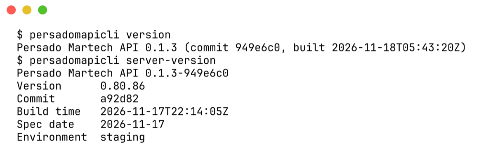

**Expected result:** the tool prints its version, commit and build time; the server prints its version, spec date and environment (`staging` here). Every command that calls the API first prints the banner line `Persado Martech API <version>-<commit>` on stderr.

`persadomapicli --help` lists the commands, and `persadomapicli COMMAND --help` describes one command with its limits and examples.

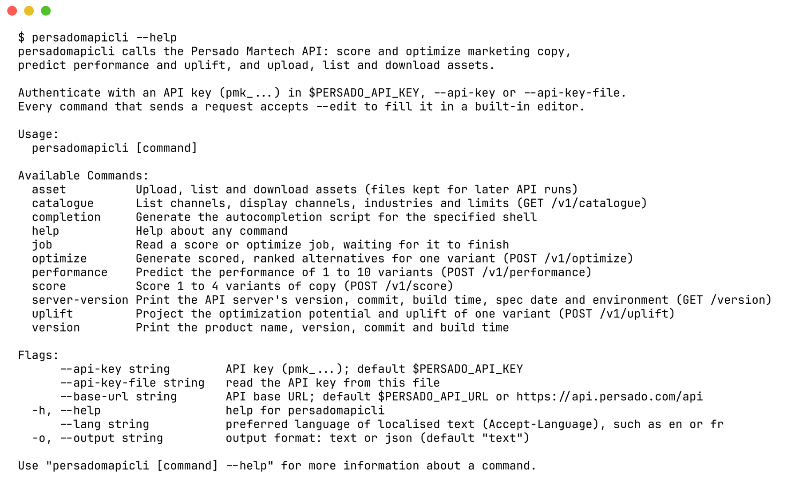

## 3. Look up channels, industries and limits

**Goal:** find the values that `--channel`, `--industry` and the variant touchpoints accept.

1. Run `persadomapicli catalogue` for every section, or pick one with `--section channels`, `display-channels`, `industries` or `limits`.

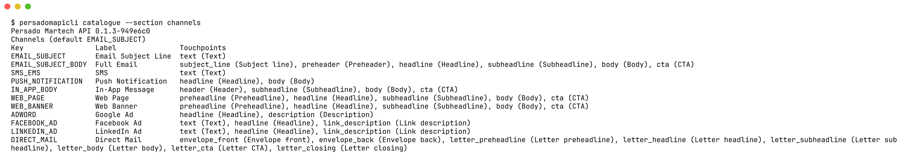

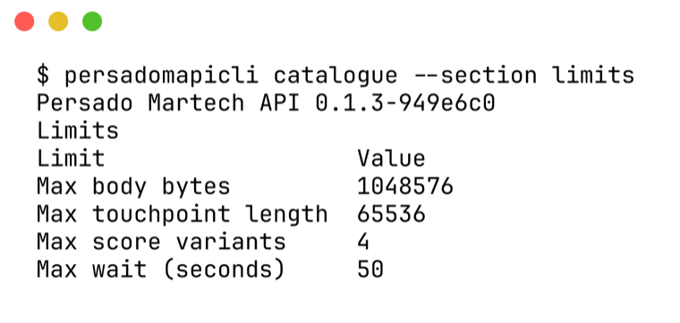

**Expected result:** a table per section. The Touchpoints column gives the keys a variant uses for that channel: `text` for `EMAIL_SUBJECT`, `headline` and `body` for `PUSH_NOTIFICATION`.

## 4. Score copy

**Goal:** get predicted performance, brand fit and compliance risk for 1 to 4 variants.

1. Name the brand with `-a/--account` (required).
2. Give each variant with `-v/--variant`. Plain text fills the channel's `text` touchpoint. For a channel with several touchpoints, pass a JSON object, such as `-v '{"headline":"Hi","body":"Apply today"}'`.
3. Optionally set `-c/--channel` (default `EMAIL_SUBJECT`), `--industry`, `--country` and `--language`.

```sh
persadomapicli score -a "Acme Bank" --industry FINANCIAL_SERVICES \
  -v "Your new card is waiting" -v "Apply in minutes and get 0% intro APR"
```

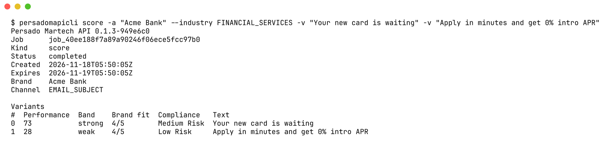

**Expected result:** the job summary, then one row per variant with its performance score (0 to 100), band, brand fit out of 5, compliance risk and text. A `-` marks a value the API did not return.

A score runs as a job. The command asks the API to hold the connection for up to 50 seconds, then polls every 2 seconds and prints dots on stderr until the job completes. `--timeout` (default 15 minutes) bounds the wait.

## 5. Run a job in the background and read it later

**Goal:** start a score or optimize job without waiting, then fetch its result.

1. Add `--async` to `score` or `optimize`. The command prints the job as soon as the API accepts it.
2. Note the job id (`job_` followed by 32 hex digits).
3. Run `persadomapicli job JOB_ID`. It waits for the job to finish; `--no-wait` prints the job as it is now.

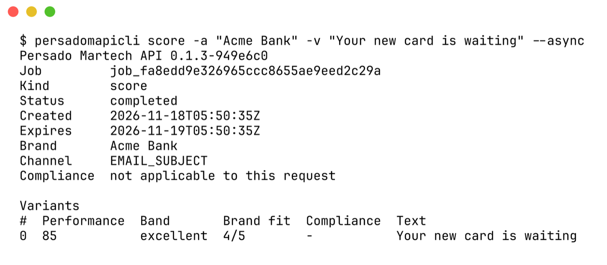

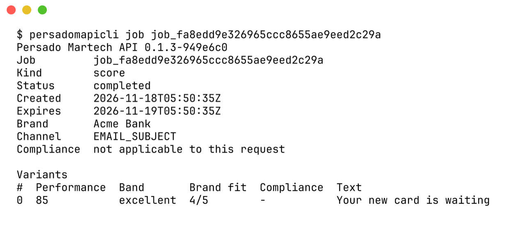

**Expected result:** `--async` prints the job with status `running`, or `completed` when the API has already finished it, as in this run. `job` prints the same result as a waiting `score` would. The API keeps a job for 24 hours after it was created; the Expires line gives the time.

## 6. Generate alternatives with optimize

**Goal:** get scored, ranked rewrites of one variant.

1. Name the brand with `-a` and give one variant with `-v`.
2. Optionally add background with `--context` (no personal data), terms every alternative must contain with `--always-use`, maximum lengths with `--char-limit KEY=N`, and brand rules with `--brand-file`, `--style-set` or `--exclude`.

```sh
persadomapicli optimize -a "Acme Bank" --industry FINANCIAL_SERVICES \
  -v "Apply in minutes and get 0% intro APR" \
  --context "Spring campaign: 0% intro APR for 15 months"
```

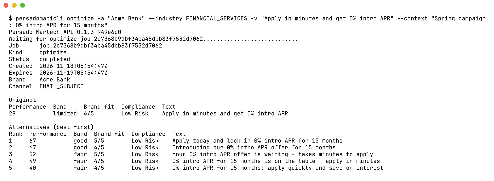

**Expected result:** the original with its scores, then the alternatives ranked best first. Optimize takes longer than score, typically a few minutes, and prints a dot per poll while it waits. When no alternative beats the original by enough, the API returns none and the Notice line says why (`performance_floor`).

## 7. Predict performance

**Goal:** compare 1 to 10 variants by predicted performance, without starting a job.

1. Name the brand with `-a` and give each variant with `-v`.

```sh
persadomapicli performance -a "Acme Bank" \
  -v "Your new card is waiting" -v "Apply in minutes" -v "Get 0% intro APR today"
```

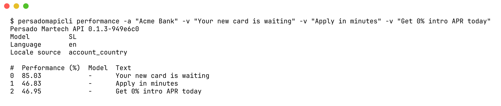

**Expected result:** the model, resolved language and locale source, then one row per variant with its predicted performance in percent, to two decimals. The answer is immediate.

## 8. Project uplift

**Goal:** see how far one variant is from its optimization potential, and the uplift per response category.

1. Name the brand with `-a` and give one variant with `-v`.
2. Optionally choose categories with `--category Click`, `Conversion` or `Open` (repeatable; default Click and Conversion).

```sh
persadomapicli uplift -a "Acme Bank" -v "Apply in minutes and get 0% intro APR"
```

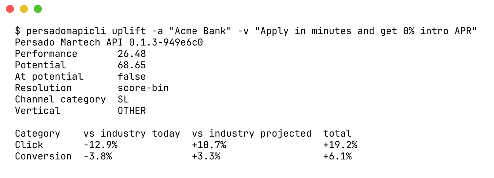

**Expected result:** the current performance and the potential, then a row per category. Each row gives the variant against today's industry average, the projected optimized result against the industry, and the total uplift, in percent.

## 9. Fill a request in the built-in editor

**Goal:** write or correct a request as JSON in the terminal, with the allowed values in view.

1. Add `-e/--edit` to any command that takes input. Flags you pass are filled in.

   ```sh
   persadomapicli score -a "Acme Bank" --edit
   ```

2. Edit the JSON. Lines that start with `//` list the allowed values and are ignored.
3. Press **Ctrl+S** to validate and run. If the request is invalid, the editor stays open and shows the error in red above the key bar.
4. Press **Esc** to cancel. If you changed the text, the editor asks for confirmation; press **Y** to discard.

The editor runs inside the tool and starts no external program, so it behaves the same on macOS, Linux and Windows. It needs an interactive terminal.

| Key | Action |
|---|---|
| Ctrl+S | Validate and run |
| Esc | Cancel (asks first if you changed the text) |
| Ctrl+R | Reset the text to the template |
| Ctrl+K | Delete to the end of the line |

The template, with the brand name given by `-a`, after Ctrl+S on an empty variant:

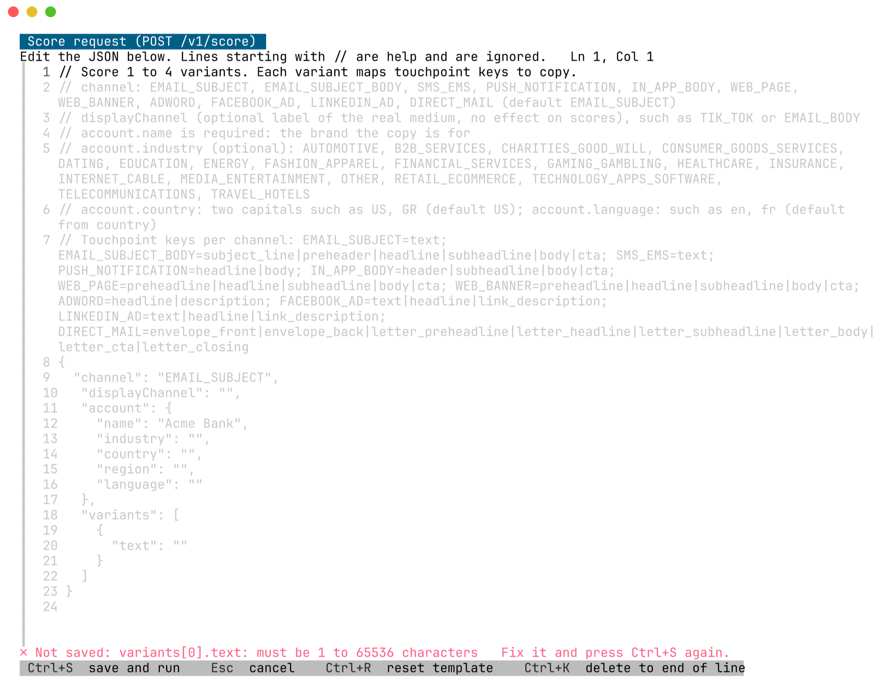

Esc after a change asks before discarding it:

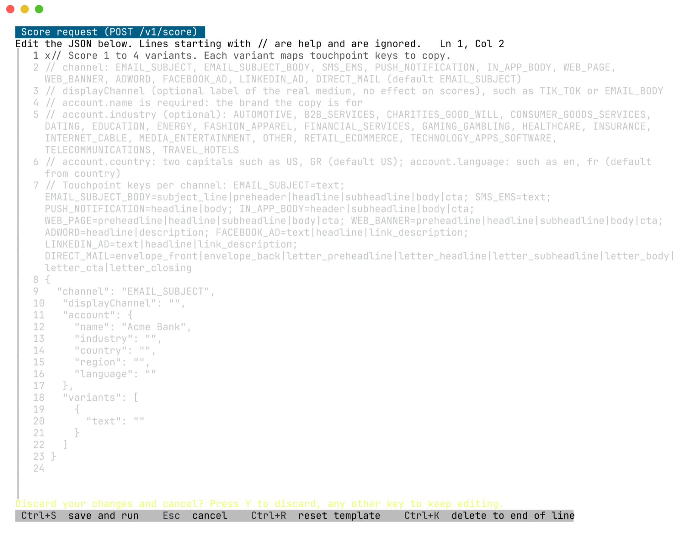

A template pre-filled from flags (`performance -a "Acme Bank" -v "Your new card is waiting" --edit`):

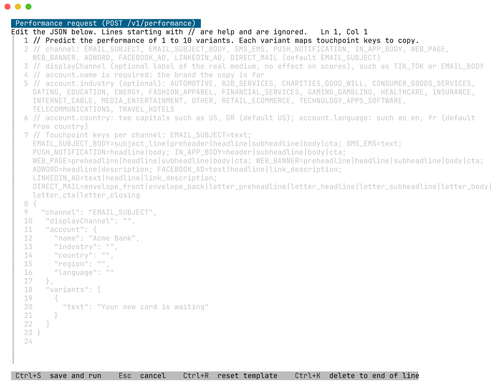

After Ctrl+S the editor closes and the command runs:

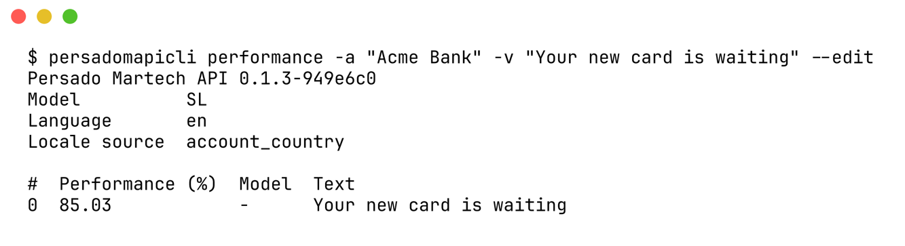

**Expected result:** the same output as the command without `--edit`. Esc ends the command with `error: edit canceled` and exit code 1, and nothing is sent.

## 10. Upload, list and download assets

**Goal:** store files with the API for later runs, and get them back.

### Upload

1. Run `persadomapicli asset create FILE...` (alias `asset upload`). Each file is checked before the first upload: a non-empty regular file of at most 10 MiB.
2. Optionally set `--expires-in-days` (1 to 90, default 30), `--attr KEY=VALUE` (up to 20), `--mime-type` and, for one file, `--name`.

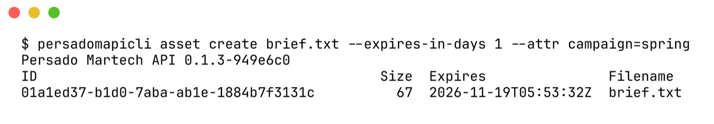

**Expected result:** one row per uploaded file with its asset id, size, expiry and stored file name. A failed upload does not stop the others; failures are listed on stderr and the exit code is 1.

An absolute path, or one containing `..`, is stored as its base name only, so your directory layout is not sent.

### List

1. Run `persadomapicli asset list`. `--limit` sets the page size (1 to 200, default 50), `--cursor` continues from a previous page, and `--all` follows every page.

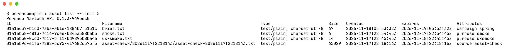

**Expected result:** your assets, newest first. Expired assets are not listed. When more pages exist, the next cursor is printed on stderr.

### Get a download link

1. Run `persadomapicli asset get ASSET_ID`.

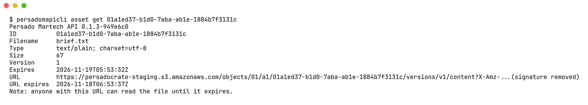

**Expected result:** the asset's metadata and a presigned download URL valid for one hour. Anyone who holds the URL can read the file until it expires, so do not share it. The screenshot removes the URL's signature.

### Download

1. Run `persadomapicli asset download ASSET_ID`. The file is saved under its own name in the current directory; `--out PATH` saves it elsewhere, and `--out -` writes it to stdout.

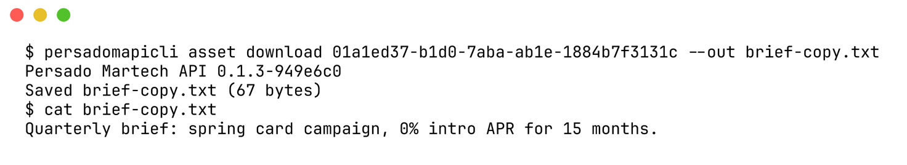

**Expected result:** `Saved PATH (N bytes)` on stderr. An existing file is not overwritten unless you pass `--force`. The tool writes to a temporary file and renames it, so a failed download leaves no partial file.

The API has no delete operation; an asset is removed when it expires.

## 11. Get JSON for scripts

**Goal:** feed the API's answer to another program.

1. Add `-o json` to any command. stdout then carries the server's JSON unchanged; the banner, progress and errors stay on stderr.

   ```sh
   persadomapicli score -a "Acme Bank" -v "Apply today" -o json > result.json
   ```

2. To send a prepared request, pass it with `--file request.json`, or `--file -` for stdin. Flags you give override fields of the file. An unknown field is an error.

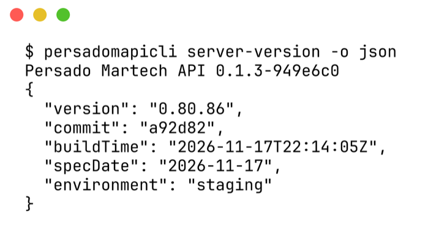

**Expected result:** valid JSON on stdout, exactly as the API returned it.

## 12. Read errors and exit codes

**Goal:** recognize what went wrong and what to do next.

Every request is validated locally before it is sent. The error names the field, the flag that sets it, and the rule. An API error adds the HTTP status, the error code and the request id; quote the request id when you contact Persado support.

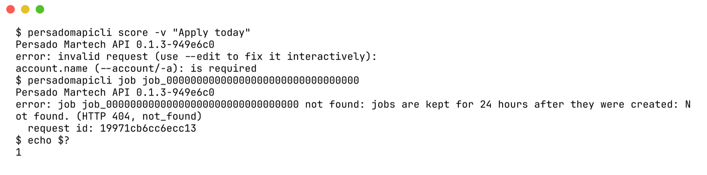

| Exit code | Meaning |
|---|---|
| 0 | Success |
| 1 | Any error: invalid input, API error, `--edit` canceled, timeout, or a job that finished as failed (the job is printed first) |

The tool resends a request up to 3 times when the API answers `429 rate_limited` or `503`, waiting for the server's `Retry-After`, at most 30 seconds each time. A job wait that reaches `--timeout` ends with the job id and the command to read it later.

## 13. Command reference

| Command | Purpose | Main flags |
|---|---|---|
| `version` | The tool's version, commit and build time | |
| `server-version` | The API server's version and environment (no key needed) | |
| `catalogue` | Channels, display channels, industries and limits | `--section` |
| `score` | Score 1 to 4 variants (job) | `-a`, `-v`, `-c`, `--industry`, `--async`, `--timeout` |
| `optimize` | Scored, ranked alternatives for one variant (job) | `-a`, `-v`, `--context`, `--always-use`, `--char-limit`, `--brand-file`, `--async` |
| `job JOB_ID` | Read a job, waiting for it to finish | `--no-wait`, `--timeout` |
| `performance` | Predicted performance of 1 to 10 variants | `-a`, `-v` |
| `uplift` | Potential and uplift of one variant | `-a`, `-v`, `--category` |
| `asset create FILE...` | Upload files (alias `asset upload`) | `--expires-in-days`, `--attr`, `--name`, `--mime-type` |
| `asset list` | List your assets | `--limit`, `--cursor`, `--all` |
| `asset get ASSET_ID` | Metadata and a one-hour download URL | |
| `asset download ASSET_ID` | Save the file | `--out`, `--force` |

Flags on every command: `--api-key`, `--api-key-file`, `--base-url`, `--lang` (language of localized text) and `-o text|json`. Commands that take input also accept `-f/--file` and `-e/--edit`. `COMMAND --help` lists every flag with its allowed values.
