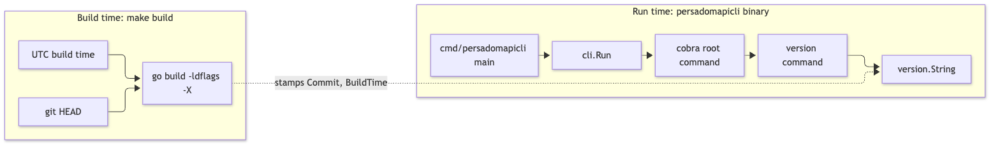
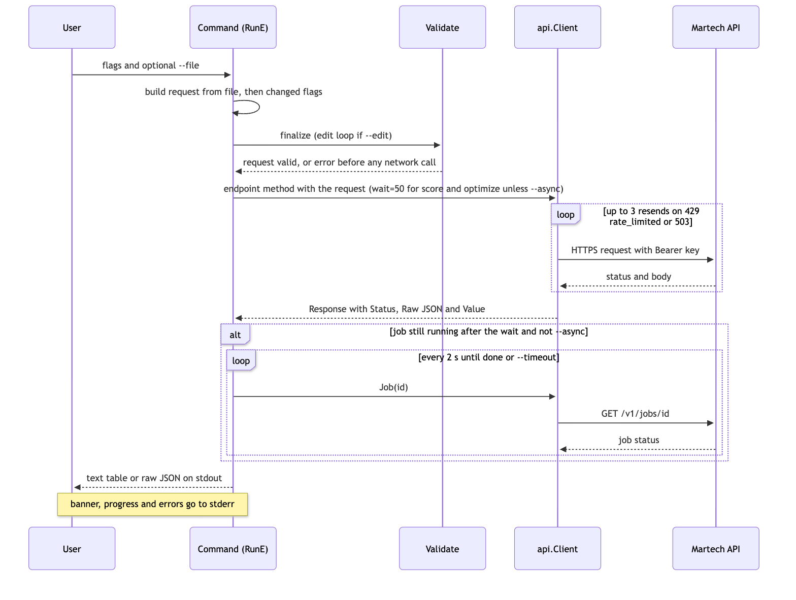
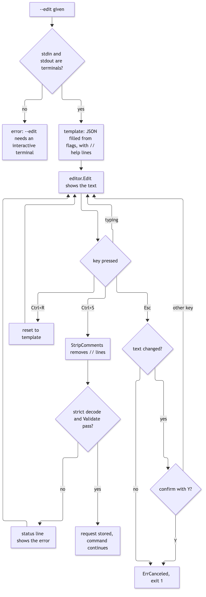

# Architecture

`persadomapicli` is a single static Go binary. `main` hands its arguments to `cli.Run`, which builds a cobra command tree, checks GitHub for a newer release alongside the command, and returns the process exit code. The build stamps the commit and build time into the `version` package.

Diagram source: [diagrams/architecture.mmd](diagrams/architecture.mmd)

## Source layout

| Path | Contents |
|---|---|
| `src/cmd/persadomapicli/main.go` | Entry point. Calls `cli.Run` with `os.Args[1:]`, stdout and stderr, then exits with the returned code. |
| `src/pkg/cli/root.go` | Root cobra command and `Run`. `Run` prints a returned error as `error: <message>` on stderr and returns exit code 1. The root's `PersistentPreRunE` validates `--output` and prints the API banner for commands annotated `annotationAPI`. |
| `src/pkg/cli/common.go` | Persistent flags (`globalFlags`), `client()` (key and base URL resolution), `apiCommand`, `runEditor`, `finalize` (validation or the edit loop), `loadFile` (strict JSON), ordered-JSON templates, `accountFlags` and variant parsing. |
| `src/pkg/cli/score.go`, `optimize.go`, `performance.go`, `uplift.go` | The request commands. Each builds the request from `--file`, then flags, calls `finalize`, calls the client and prints text or raw JSON. `score.go` is the pattern the others follow. |
| `src/pkg/cli/job.go` | `job` command, `waitFlags` (`--async`, `--timeout`), `waitJob` (polling) and the job renderers. A failed job returns `errJobFailed`. |
| `src/pkg/cli/catalogue.go`, `server_version.go` | Read-only commands without a request body. |
| `src/pkg/cli/asset.go` | `asset` parent command. |
| `src/pkg/cli/asset_create.go`, `asset_list.go`, `asset_get.go`, `asset_download.go` | `asset create` (alias `upload`), `list`, `get` and `download`. |
| `src/pkg/cli/version.go` | `version` command. |
| `src/pkg/api/client.go` | `Client.Do`: bearer authentication, `Accept-Language`, retries, and `*api.Error` for non-2xx responses. |
| `src/pkg/api/endpoints.go` | One method per operation, returning `*Response[T]` with the HTTP status, the raw JSON and the decoded value. |
| `src/pkg/api/models.go`, `validate.go` | Request and response types. `Validate()` on each request returns an `api.ValidationError`, a list of field and reason pairs. |
| `src/pkg/editor/editor.go` | `Edit`, the full-screen editor behind `--edit`, built on Bubble Tea v2, and `StripComments`. |
| `src/pkg/version/version.go` | `const Version` (Rule 8), `const Product`, the `Commit` and `BuildTime` stamps, and the `String` (full), `Short` and `Banner` formats. |
| `src/pkg/update/update.go` | `Latest` (latest release tag from GitHub), `Newer` (SemVer comparison) and the install one-liners. |

Developer-key endpoints (`/v1/devkeys/*`) are not part of the tool.

## Request flow

Diagram source: [diagrams/command-flow.mmd](diagrams/command-flow.mmd)

1. The command builds the request from `--file` (strict JSON, `-` reads stdin) and then applies the flags the user changed. A flag overrides the file.
2. `finalize` calls `Validate()`. With `--edit` it opens the editor instead and repeats the validation on each save. No network call happens before the request is valid.
3. `globalFlags.client` resolves the key from `--api-key`, then `--api-key-file`, then `PERSADO_API_KEY`, and the base URL from `--base-url`, then `PERSADO_API_URL`, then `https://api.persado.com/api`.
4. `Client.Do` sends the request. On `429 rate_limited` or `503` it resends up to 3 times, waiting for `Retry-After` or the body's `retryAfterSeconds`, otherwise 1, 2 and 4 seconds, capped at 30 seconds. `429 quota_exhausted` and other statuses are not retried.
5. `score` and `optimize` return a job. Unless `--async` is set, the request carries `wait=50` and the API holds the connection for up to 50 seconds. If the job is still running, `waitJob` reads it every 2 seconds until it finishes or `--timeout` (default 15 minutes) passes.
6. Output goes to stdout as a table, or as the server's raw JSON with `-o json`. The banner, job progress and errors go to stderr.

## Editor

Diagram source: [diagrams/edit-flow.mmd](diagrams/edit-flow.mmd)

`finalize` passes the editor a template built from the flags, with `//` help lines that list the allowed values. `runEditor` refuses to start unless stdin and stdout are terminals. On `Ctrl+S` the editor removes the `//` lines, decodes the text strictly and runs the same `Validate()` as the non-interactive path. A failure shows on the status line and the editor stays open. `Esc` leaves at once if the text is unchanged, and otherwise asks for confirmation. A canceled edit returns `editor.ErrCanceled`. `runEditor` is a package variable so that tests replace it.

## Error model

- Commands return errors from `RunE`. `Run` prints `error: <message>` on stderr and returns exit code 1. There is no other non-zero code.
- `api.ValidationError` lists each invalid field with the reason. It is raised locally, before any request.
- `*api.Error` holds the HTTP status, the API error code, message, request id, per-field details and any personal-data categories the API reports. Its text shows all of them.
- A job that finishes as failed is printed, then returns `errJobFailed`, so the exit code is 1. A job still running at `--timeout` returns an error that names the job id.
- `asset create` uploads each file in turn. A failed upload does not stop the others, and the exit code is 1 if any failed.

## Build stamping

`make build` passes `-ldflags "-X .../version.Commit=<short HEAD> -X .../version.BuildTime=<UTC RFC 3339>"`. A binary built without the Makefile (`go build`, `go install`) reports `unknown` for both stamps. `Version` is a constant and is never stamped: it changes only through a commit to `version.go`.

## Update check

`cli.Run` starts `update.Latest` in a goroutine before it executes the command. `Latest` sends a `HEAD` request to `https://github.com/persado/martechapi-cli/releases/latest` without following the redirect, and takes the version from the `vX.Y.Z` tag at the end of the `Location` header. After the command returns, `Run` waits for the result for at most `updateWait` (2 s), then cancels the request. If `update.Newer` reports a higher version, `Run` prints the notice on stderr with the one-liner for the current OS: `install.ps1` on Windows, `install.sh` elsewhere. Any error, including no network, prints nothing.

## Release builds

`make dist` cross-compiles the same `main` package with `CGO_ENABLED=0` for `windows/amd64`, `windows/arm64`, `linux/amd64`, `linux/arm64` and `darwin/arm64` (the `PLATFORMS` variable), names each binary `persadomapicli-<os>-<arch>` with `darwin` shown as `macos` and `.exe` on Windows, and writes `SHA256SUMS`. The `release` workflow runs it on every push to `main` and attaches the output to release `vX.Y.Z`.

## Adding a command

1. Create `src/pkg/cli/<command>.go` with a `new<Command>Cmd() *cobra.Command` constructor, and its companion `<command>_test.go` (Rule 5).
2. Register it in `newRootCmd` with `root.AddCommand`.
3. Write output to `cmd.OutOrStdout()` and return errors from `RunE`, so tests can drive the command through `Run` with buffers.
